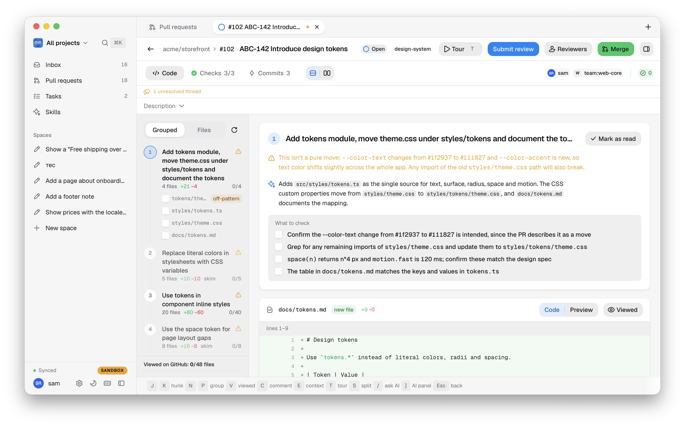
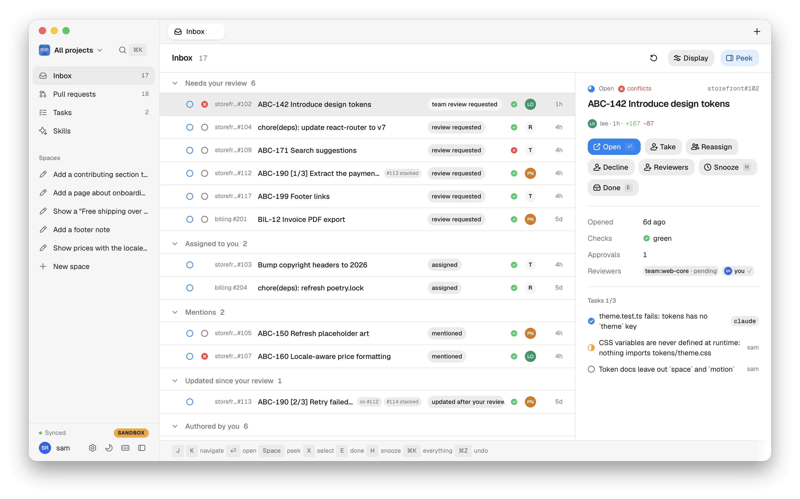
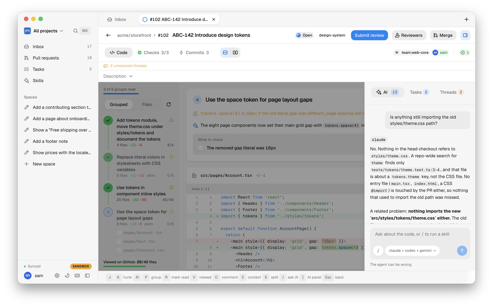
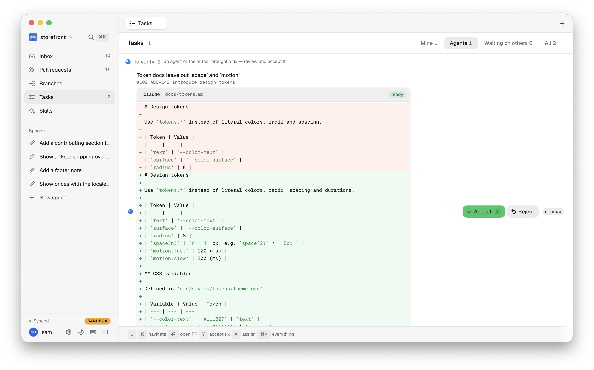
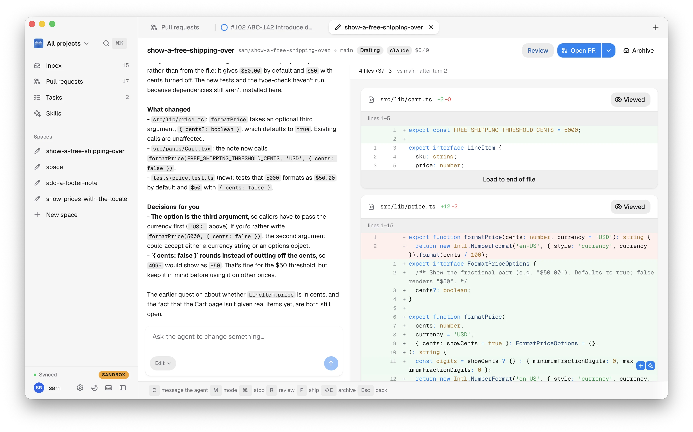

<p align="center">
  
</p>

<h1 align="center">Theodore</h1>

<p align="center">
  <b>Review pull requests by meaning, not by file order.</b>
</p>

<p align="center">
  Your own agent CLIs — Claude Code, Codex, Gemini CLI — run on your machine.<br>
  Agents never post to the PR — you decide what goes out.<br>
  One inbox for your GitHub pull requests.<br>
  macOS · local-first · keyboard-first
</p>

Theodore is a desktop app for code review. It pulls your pull requests into one
inbox, checks each PR out into its own git worktree, and has the agent CLI you
already use regroup the diff into the steps the change actually takes. You read
it group by group, ask the agent about any line, run review skills, and turn
what you agree with into comments. The agents help; you decide what goes out.

## Why Theodore

Agents now write more code than people can read. Review is the bottleneck.

| Problem | How Theodore answers it |
| --- | --- |
| A diff in file order hides the story: the model, the API that uses it and its tests sit far apart. | The diff is grouped by meaning into titled groups, each with a *why*, a risk and a checklist, read in order. |
| A big PR has no sense of "done". | A progress line ("3 of 5 groups read"), per-hunk read state, and after a push only the new or changed hunks are flagged. |
| AI review bots post their noise straight onto the PR. | Findings stay in the app. You turn the ones you agree with into drafts, which go out together as one review when you submit (Bitbucket has no batched review: each comment posts at once). |
| Cloud review tools want your code on their servers. | Theodore has no review server. It runs the agent CLIs you already have installed and logged in, inside a local worktree; code goes only where your CLI already sends it. |
| Review means juggling the host's website, a local checkout and a chat. | One window: inbox, diff, threads, checks, merge, an AI chat scoped to the diff, ⌘-click definitions across the worktree. |
| Flaky Wi-Fi breaks web review. | Local-first: state lives in SQLite, host writes queue in a resumable outbox and go out when you're back online. |
| The mouse is slow. | Keyboard-first: lists, reading and marking read by key; ⌘K finds every action and PR; `?` shows the shortcuts. |
| An idea still has to become a PR before anyone can review it. | *Spaces*: an agent writes the change in its own worktree while you chat and review it grouped, then **Open PR**. |

```
                    git diff (file order)          Theodore (meaning order)
                    ─────────────────────          ─────────────────────────
                    api/handler.ts                 1. new data model
                    db/migration.sql                  db/migration.sql
                    model/user.ts         ──▶         model/user.ts
                    tests/user.test.ts             2. API using it
                    ui/profile.tsx                    api/handler.ts
                                                       ui/profile.tsx
                                                    3. tests
                                                       tests/user.test.ts
```



| | |
| --- | --- |
|  **Inbox** — review requests, assignments and mentions in sections. |  **AI panel** — ask about the change; the agent reads the diff. |
|  **Tasks** — an agent's fix comes back as a patch to accept or reject. |  **A space** — the conversation beside the live diff, then Open PR. |

All screenshots: [docs/screenshots](docs/screenshots/README.md).

## What works today

### Inbox and triage
- One inbox in sections: review requested, assigned, authored, mentioned.
- Snooze until a push, until checks go green, or for a fixed time; it wakes on its own.
- Triage a review request: take, decline or reassign.
- Keyboard-first: list navigation, ⌘K command palette, `?` for shortcuts.

### Pull requests and branches
- The workspace's PRs in one list: All (open), Mine (grouped by what each needs to merge), Drafts, Merged.
- A Branches page per project: ahead/behind, the PR a branch belongs to, a local folder's checked-out
  branch and uncommitted files.

### Projects and workspaces
- Add, browse and remove projects from any configured host, or a local folder.
- The sidebar's switcher scopes the app to *All projects* or one project.
- Each keeps its own tabs, filters and position, restored on switch.
- ⌃0 / ⌃1…9 switch directly; drag projects in Settings → Projects to set the order.
- A local review of a branch against its project's base: no hosted PR, no host actions, not in PR counts.

### The review screen
- The diff grouped by meaning into titled groups, each with a *why*, a checklist and a risk.
- A progress line, "N of M groups read"; `R` marks the current group read and moves to the next unread one.
- Per-hunk read state, keyboard-driven reading.
- Groupings are versioned: one from an older algorithm is redone on open; ↻ regroups from scratch.
- Interdiff: after a push only new or changed hunks are flagged, with a "what changed" view.
- Markdown diffs get a rendered Preview; image diffs show side by side, swipe or onion skin.
- ⌘-click an identifier for definitions and references across the worktree (`git grep` plus
  per-language patterns, not a language server).
- The header is two rows: number, title, status and actions, then the Overview / Checks / Commits /
  Code tabs. Overview holds the full title, branches, reviewers and approvals, labels and the
  description.
- After a push, Whole PR / Since last visit: the baseline holds until you've read what changed.
- Colour literals in code get a swatch; hover it for the colour in hex, rgb and hsl.
- Narrow windows: the preview hides itself beside lists, the review header goes icon-only.

### Status at a glance
- One status mark per PR in tabs, lists, the preview and the header: a red cross while checks fail,
  it conflicts with its base or changes are requested; otherwise a ring coloured by state (draft,
  checks running, ready to merge, open) and filled with how much you've read.

### Comments, suggestions and reactions
- Threads: reply and resolve, written back to the host.
- Draft comments, submitted together as one review.
- Suggested-change blocks, applied as a commit on the branch.
- Reactions.

### The AI panel
- Chat scoped to a PR, a group or a single line.
- The agent reads what the PR changed through the review tools (the worktree holds only the head),
  so answers are about the diff.
- Skills are `SKILL.md` files: three built in (`bugs`, `security`, `tests`), plus `~/.claude/skills`
  and the repo's `.claude/skills`.
- Run one from the `/` list in the chat input: type to filter, Enter runs it; the list's footer
  has **Manage skills…**.
- Several configured skill agents run in sequence; their findings merge.
- A finding becomes a draft comment or a task, or gets a proposed fix attached.
- Tasks: an agent edits inside the PR worktree.
  Accept commits and pushes (your own or a local PR) or drafts a suggestion (someone else's PR).
  Reject resets the worktree.

### Merge, checks and conflicts
- Merge, enqueue, auto-merge, update branch; change reviewers and draft state; re-run a check.
- Conflicts are computed locally against the base branch tip with `git merge-tree --write-tree`,
  not read from the host's possibly stale mergeability flag.

### Hosts
| | GitHub | GitLab | Bitbucket Cloud |
| --- | --- | --- | --- |
| Server-side viewed state | yes | no | no |
| Batched review (drafts → submit) | yes | yes | no — posts immediately |
| Resolve thread | yes | yes | yes |
| Suggestions | yes | yes | no |
| Merge queue / auto-merge | yes | no queue, has auto-merge | no |
| Reactions | yes | yes | no |
| Auth | keychain → `gh auth token` → `GITHUB_TOKEN` → OAuth device flow | personal access token | app password or access token |

GitHub is the most complete adapter, and the only host on by default.
GitLab and Bitbucket are real, tested adapters too, narrower to match each host's API. They are
behind Settings → Labs, off by default: until you turn one on, its sign-in, its repositories in
Add project and its PR links stay hidden. Projects and reviews you already added keep working.

### Linear (read-only)
- Behind Settings → Labs, off by default; with it off there is no Integrations page and no chips.
- Issue keys in a PR's title, branch name or body show as chips in the preview and the review's Overview tab.
- No token stored means an empty list, never an error. No write-back.

### Settings
- Sign-in per host.
- Appearance: System (follows macOS, the default), Light or Dark; also an onboarding step.
- About: version, commit and build (`production`, `staging`, `nightly`, `dev`), with Copy for bug
  reports.
- The account menu under your name in the sidebar: Settings, Report a problem, Sign out.
- Labs: per-machine switches for features in progress (Linear, GitLab, Bitbucket), all off by
  default. They may change or go away.
- Agent per task: grouping, chat, skills, fix — Claude by default for each.

### Theodore account (required where configured)
- Where the account is configured, sign-in is required.
  Until then the window shows only the sign-in, the core refuses every command that does work
  (`account_required`), and the poller and outbox wait. It is onboarding's first step, with no Skip.
- Your email opens the hosted sign-in page on its code step; Theodore picks the sign-in up when you
  finish. A device code covers signing in from another machine.
- Client-only (PKCE, no secret in the app). The installed app gets the sign-in back through
  `theodore://callback` (`theodore-staging://` / `theodore-nightly://` for those builds), a dev
  run through a loopback redirect. Session in the keychain.
- Offline is fine: a stored session keeps the app usable; only a definitive rejection signs you out
  ("Your session ended — sign in again"). Signing out (Settings → Account) never deletes local data.
- The client id comes from `THEODORE_WORKOS_CLIENT_ID` (env, or compiled into release and nightly
  builds) or the `account.workos.client_id` setting. A dev build without one has no account;
  sandbox and fixture modes never do. Setup: `docs/plan.md` §6.12.

### Spaces
A *space* is a change before it is a PR.

```
New space "fix-login" ─▶ worktree @ base ─▶ agent turn ─▶ checkpoint ─▶ live diff
        ▲                                                                  │
        └──── comment / thread / finding ─▶ "Send to agent" ◀── Review ▸ ──┘
                                                                           │
host project:  Open PR (one squashed commit on <login>/<slug>) ─▶ Push more turns
local folder:  Merge locally  ·  Keep as branch
```

- Modes per turn: Ask (read only), Edit, Run (edit plus shell commands).
- The project config's `setup` / `run` / `check` / `archive` commands run with the space; logs on
  the space page, **Open app** for the `run` command's port.
- Undo the last turn: worktree and ref go back to the previous checkpoint.
- "Send to agent" on a draft, a finding or a thread of the space's PR or own review makes it the
  next turn.
- A turn that ends while the window is in the background sends a system notification
  (`spaces.notify`); clicking it opens the space. The dock badge counts spaces waiting on you.
- Archive any time, or automatically `spaces.auto_archive_days` after shipping.
- On for everyone; Settings → Spaces turns them off (the `labs.build_mode` setting). Design:
  `docs/spaces.md`.

### Project config
- Three layered files: `.theodore/config.yaml` in the repo (shared), `.theodore/config.local.yaml`
  (yours), `~/.theodore/config.yaml` (global). Every key: `docs/config.md`.
- `review:` picks agents per task, feeds the repo's instructions and files to every agent run, hides
  or marks files skimmable in the grouping, adds checklist items, auto-runs skills, drops findings
  by path.
- A review reads `review:` from the base branch, so a PR can't change how it is itself reviewed.
- `spaces:` sets up a space: files to copy, free ports, env, and the `setup` / `run` / `check` /
  `archive` commands. Commands from a repo run only after you allow them.
- Settings → Projects → ⟨project⟩ → Config creates the file from your current settings, checks it as
  you type, and saves it to the repo (a PR for a host project), your local file or the global one.

### Updates
- Checks for a new build on launch and every 6 hours: production builds on the stable (or beta)
  channel, staging builds only on the staging one. Releases: GitHub Releases, from v0.1.0.
- Restarts only once no agent is running and the outbox is empty.
- No signed release has shipped yet — see **Not yet**.

### Logs, error reports and usage data
- Everything is logged locally to `<data dir>/logs/theodore.jsonl` (`~/.theodore` in production; JSON
  lines, rotated, ≤ 50 MB).
- Redacted first: tokens, emails, the home directory; diff, file and comment text are never logged.
  `THEODORE_LOG=debug` for more; `jq` recipes in `docs/telemetry.md`.
- Two remote sinks, off unless the build or settings configure them *and* you opt in (onboarding's
  "Help improve Theodore", or Settings → About & updates): error reports over OTLP (e.g. New
  Relic) and typed product events to PostHog.
- Both use a random install id, not your account; repository names are hashed.
- **Report a problem** (Help menu, Settings, the error screen) opens a public GitHub issue as you —
  your comment plus app info, optionally the newest redacted logs, previewed first — or just zips
  the logs locally. Events, codes, rules and settings: `docs/telemetry.md`.

## How it works

```
UI (React + MobX object pool, resource() cache for immutable data)
   │   Tauri IPC: commands / events
   ▼
Rust core — same code inside the desktop app and the `theodore` CLI
   contract → app (use cases, sync engine, outbox, poller)
                │
              domain (pure logic: groups, anchors, interdiff,
                      findings, tasks, snooze — no I/O)
                ▲
              ports (Host · Git · Agent · Store · Secrets · Clock)
                ▲
   ┌────────────┼───────────────┬──────────────┬───────────┐
host-github   git (CLI;     agents (claude/   mcp           store
host-gitlab   one worktree  codex/gemini      "review-tools" (SQLite)
host-bitbucket per PR;      runners; stream   HTTP server +  secrets
(+ host-http:  conflicts    parsing, cancel/  per-run token; (keychain)
 ETag, retry,  via          stall, cost)      stdio bridge
 rate limit)   merge-tree)                    for stdio-only CLIs
```

**Local-first sync.**

```
UI edit ──▶ transaction ──▶ core validates (domain) ──▶ SQLite + sync log (id N)
                                   │
UI  ◀── sync{actions, N} event ────┤
                                   └──▶ outbox ──▶ host write (resumable, idempotent)

poller (ETag poll of open PRs, cursor poll of the inbox) ──▶ same apply path ──▶ sync log ──▶ UI
```

- Every change — yours, an agent's, or one the poller noticed — is one `SyncAction` with an
  increasing id.
- The UI has one inbound stream and one object pool fed by it.
- Host writes go through the outbox: resumable steps, an idempotency marker so a retried comment
  isn't posted twice, backoff by error kind.

**Grouping.**

```
diff ─▶ hunks ─▶ pre-pass (hide lockfiles/generated/vendored; flag pure
                 renames/whitespace-only/import-only as skim candidates)
      ─▶ relatedness graph (imports, symbols, names, tests ↔ source,
                            git co-change) ─▶ communities of related files
      ─▶ large PR: one chunk per community (top-level dir as fallback),
                   other files shown as one-line skeletons, ≤ 3 chunks in flight
      ─▶ one agent call per chunk ─▶ validate (must partition all hunk ids)
             ├─ ok ──────────────────────────▶ groups
             └─ invalid ─▶ one repair call ─▶ still invalid ─▶ "Other"
      ─▶ merge pass (order across chunks) ─▶ coarsen (merge tiny groups)

push ─▶ unchanged hunks keep their group ─▶ only new/changed hunks go to the agent
```

- Each stored grouping carries an algorithm version (`ALGO_VERSION`, currently `3`).
- Opening a PR grouped by an older version regroups it; ↻ in Review forces it.

## Run it

Prerequisites:
- Rust stable (edition 2024, `rust-version = "1.90"`, pinned in `rust-toolchain.toml`).
- `pnpm` for the `ui/` workspace.
- `git` ≥ 2.38 — conflict detection needs `merge-tree --write-tree`.
- `cargo install tauri-cli --version "^2" --locked`, for `cargo tauri …`.
- At least one agent CLI, installed and logged in: `claude`, `codex` or `gemini`.
  Claude Code's runner is the best-tested; Gemini's flags are unverified against a real install.

Dev:

```sh
cd apps/desktop
cargo tauri dev --no-watch
```

A dev build keeps its own data in `~/.theodore-dev` and its own keychain item, never production's
`~/.theodore`; its first launch starts empty (onboarding). Staging and nightly builds are separate
apps too (`Theodore Staging`, `Theodore Nightly`, `~/.theodore-staging`, `~/.theodore-nightly`),
installed beside production; nothing is copied between them (`docs/releasing.md`, "One identity per
build"). `THEODORE_DATA_DIR` overrides the data dir in any build.

Release build:

```sh
cargo tauri build
```

Auth:
- GitHub tries, in order: a keychain token, `gh auth token`, `GITHUB_TOKEN`, then the "Sign in with
  GitHub" OAuth device flow once `THEODORE_GITHUB_CLIENT_ID` (or the `host.github.client_id`
  setting) is set.
- GitLab and Bitbucket (once on in Settings → Labs) take a pasted token or app password
  (`GITLAB_TOKEN` / `BITBUCKET_TOKEN`); no device flow for those yet.

Data lives in `~/.theodore` (production; the CLI too):

```
~/.theodore/
  repos/        a bare clone per repo
  wt/           a git worktree per PR
  spaces/       a git worktree per space
  theodore.db   SQLite
  logs/         theodore.jsonl
```

Sandbox: `theodore sandbox init <dir>`, then `THEODORE_SANDBOX=<dir>` runs the app against a
simulated host with its own data in `~/.theodore-sandbox` — faults, offline, scripted agents
(`docs/sandbox.md`).

Local nightly: `scripts/nightly-build.sh` builds a DMG numbered by commit count
(`docs/releasing.md`).

Releases: a push to `staging` publishes a staging build; a version bump merged to `main` publishes
a production release (`docs/releasing.md`).

CLI:

```sh
theodore group <pr-url> [--agent claude|codex|gemini] [--model <name>] [--json] [--save <dir>]
theodore eval <fixtures-dir> [--agent claude|codex|gemini] [--model <name>]   # quality + cost table
theodore mcp-bridge --url <mcp-url>   # stdio↔HTTP bridge for CLIs without HTTP MCP
theodore sandbox …                    # init a sandbox, drive its simulated host
```

## Develop

```
crates/
  domain/         models, invariants, diff/interdiff, anchors, grouping, snooze
  contract/       command + sync types; generates ui/src/gen/*.ts
  app/            use cases, sync engine, outbox, poller, settings, built-in skills
  ports/          trait definitions: HostAdapter, GitPort, AgentPort, Store, Secrets, Clock
  host-http/      shared HTTP client for GitHub/GitLab: auth, ETag, rate limit, retry, redaction
  host-github/    GraphQL + REST adapter, device-flow auth
  host-gitlab/    REST v4 adapter
  host-bitbucket/ REST adapter, its own HTTP transport (Basic or Bearer auth)
  linear/         read-only GraphQL client (issue linking)
  git/            clone, worktree, diff → hunks, conflict detection
  agents/         claude / codex / gemini CLI runners, stream parsers, process lifecycle
  grouping/       grouping pipeline: pre-pass, relatedness graph, prompt, validation, repair,
                  coarsen, incremental regroup, eval
  mcp/            "review-tools" MCP server + stdio bridge
  store/          SQLite schema, migrations, sync log, outbox
  secrets/        keychain (shells to /usr/bin/security)
  runtime/        host token resolution (keychain → gh/env fallback)
  account-workos/ Theodore account: PKCE, loopback redirect, device code, refresh
  telemetry/      one tracing stream, one redaction step; local log, OTLP, PostHog sinks
  sandbox/        simulated code host over local bare repos, fault injection, scripted timeline
  fixtures/       recorded PRs, diffs and agent streams for tests and eval
apps/
  desktop/        the Tauri app
  cli/            `theodore` — grouping eval, debugging, the MCP stdio bridge, sandbox
ui/               React app, MobX sync client, gen/ (generated TS types)
e2e/              WebDriver specs against the real core with fixture adapters
```

Checks (see `lefthook.yml` and `.github/workflows/ci.yml`):

| Part | Command |
| --- | --- |
| Rust format | `cargo fmt --all --check` |
| Rust lint | `cargo clippy --workspace --all-targets -- -D warnings` |
| Rust tests | `cargo test --workspace` |
| UI | `pnpm -C ui typecheck`, `pnpm -C ui lint`, `pnpm -C ui test`, `pnpm -C ui build` |
| Contract bindings up to date | regenerate (below), then `git diff --exit-code -- ui/src/gen` |
| Grouping quality | `theodore eval apps/cli/fixtures/` — fails below the M1 targets |
| E2E | `tauri-driver` against the real core with fixture adapters, on Linux |

Regenerating generated TS bindings:

```sh
cargo run -p theodore-contract --bin export-ts
cargo run -p theodore-desktop -- --export-bindings
```

Git hooks (`lefthook install` once per clone):
- **pre-commit** — trailing whitespace / conflict markers (`git diff --cached --check`), a large-file
  check, `cargo fmt --check` on staged Rust files.
- **commit-msg** — Conventional Commits format.
- **pre-push** — `cargo clippy --workspace --all-targets -- -D warnings`, `cargo test --workspace`,
  `pnpm -C ui typecheck`, `pnpm -C ui lint`.

## Not yet

- Notarization and a Developer ID (the release workflow has the steps, no secrets yet); builds are
  ad-hoc signed.
- Linux and Windows builds — macOS (Apple Silicon) only.
- GitLab OAuth/PKCE sign-in — personal access token only.
- Skills on several agents in parallel (they run in sequence; findings still merge).
- A Theodore server: the account sign-in is client-only; billing, sync and uploading problem
  reports need one (reports are local zips for now).
- Spaces: a "Send all to agent" footer and feedback tracked as tasks, a "Drafting" group in My PRs,
  Threads / Checks tabs on the space page, per-turn diffs, deleting a space, a queue with a
  parallel limit (`docs/spaces.md` §11).
