# Screenshots

Taken in the sandbox (`docs/sandbox.md`) — a simulated `acme/storefront` and
`acme/billing`, no real data — with real Claude runs for the grouping, the AI
answers, the skill findings, the task fix and the space. 1452×864 window,
Retina, macOS window shadow, WebP.

| | |
| --- | --- |
|  **Inbox** — review requests, assignments and mentions in sections; the preview shows a PR with its actions. | 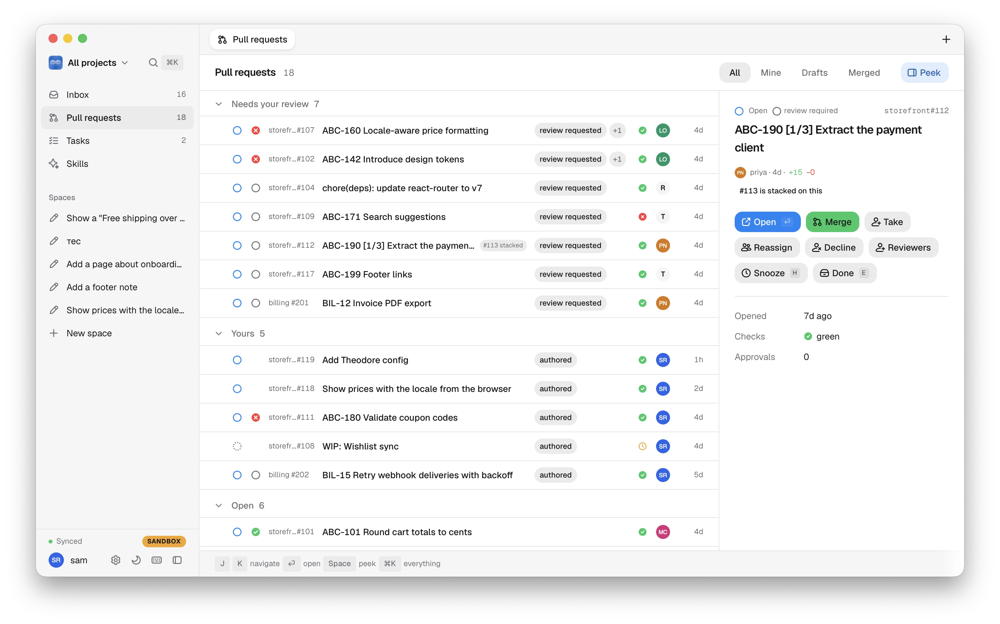 **Pull requests** — every PR of the workspace, filtered All / Mine / Drafts / Merged; Mine groups your PRs by what each needs to merge; one status mark per PR. |
|  **Review, grouped by meaning** — titled groups with a why, a risk and a checklist, read in order; a progress line counts the groups read. |  **AI panel** — ask about the change; the agent reads the diff through the review tools. |
| 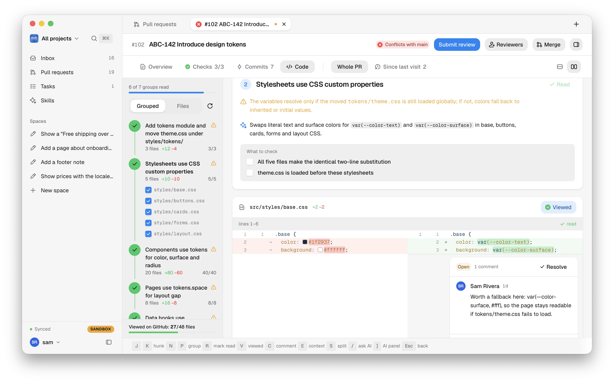 **Split diff and a thread** — reply or resolve; it goes back to the host. | 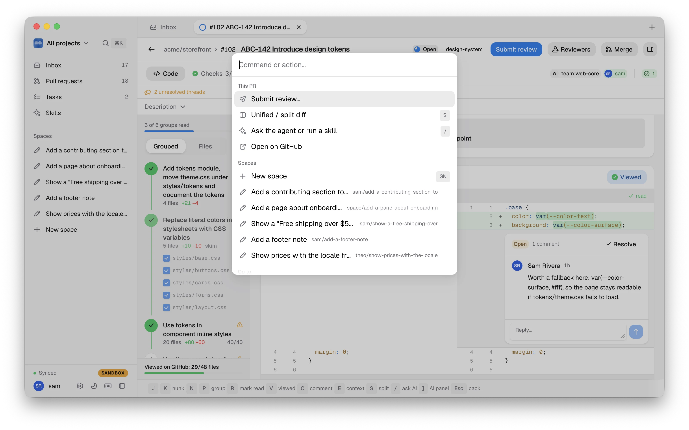 **⌘K** — every action and PR, with its key. |
| 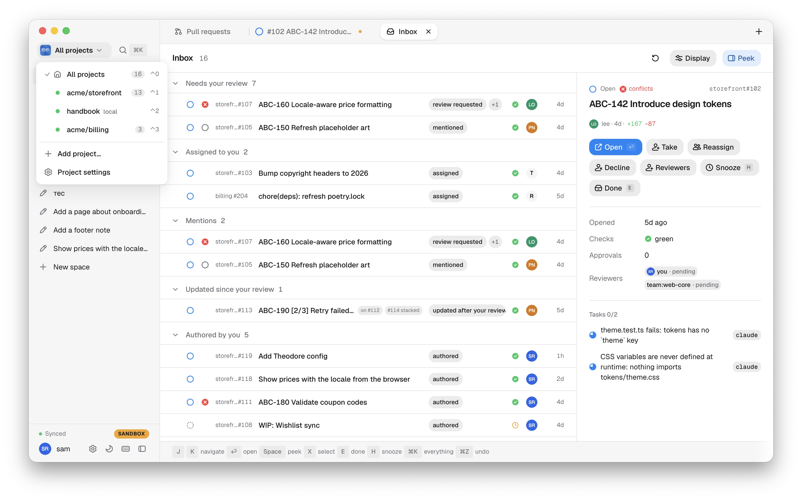 **Workspaces** — All projects or one project, ⌃0 / ⌃1…9; each keeps its own tabs. | 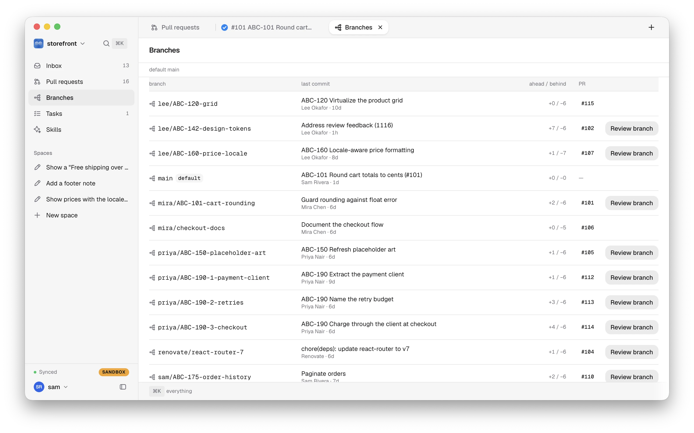 **Branches** — ahead / behind, the PR a branch belongs to, a local review of any branch. |
| 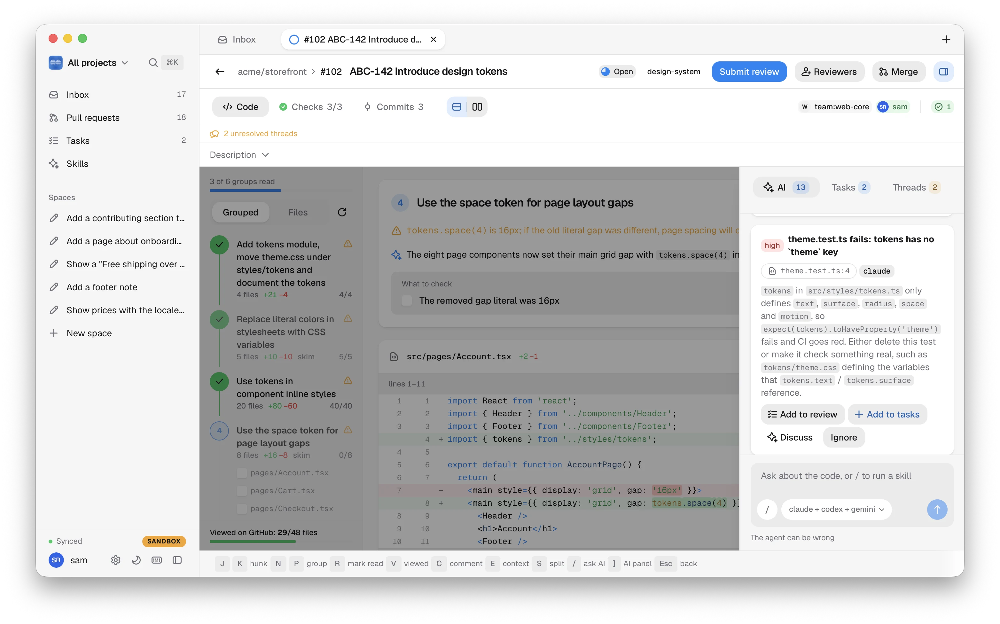 **Skills** — findings from a real `/bugs` run; colour literals get swatches; findings become drafts or tasks. |  **Tasks** — delegated to an agent, the fix comes back as a patch to accept or reject. |
| 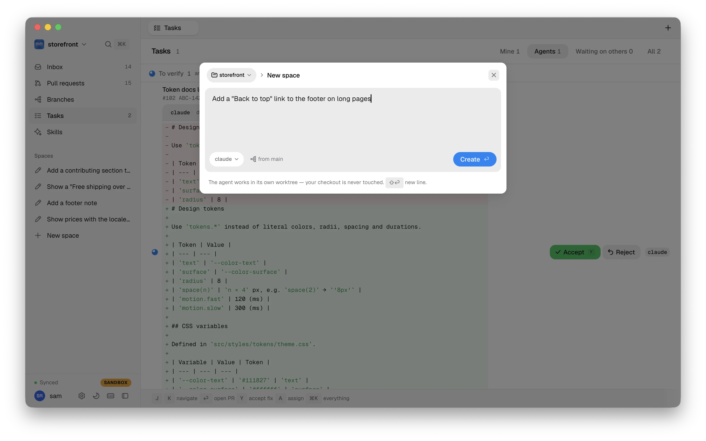 **New space** — say what to change; the agent works in its own worktree. |  **A space** — the conversation beside the live diff, then Open PR. |
| 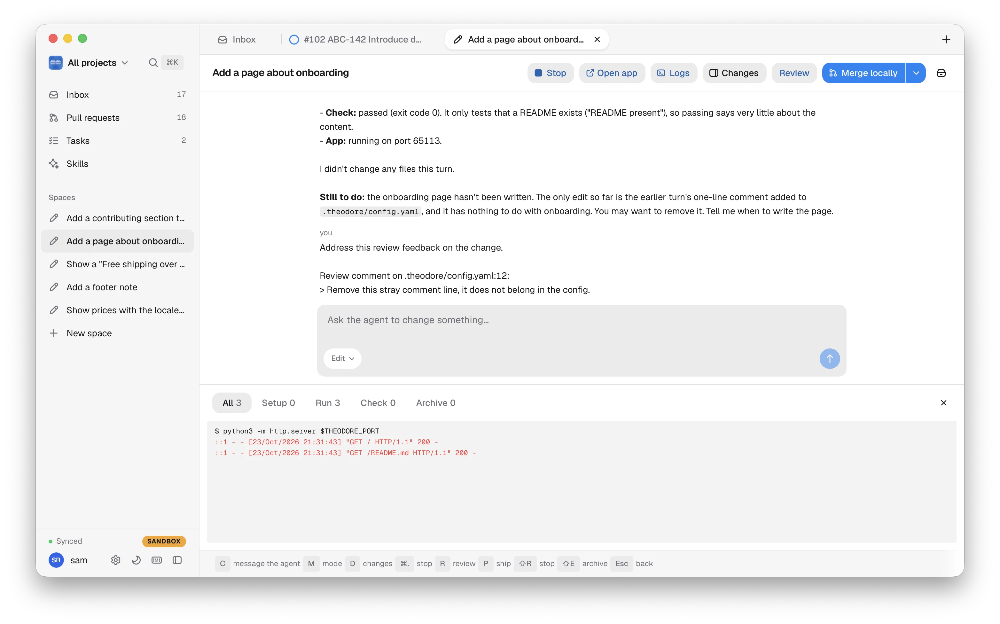 **Run the app** — the project config's `run` command, Open app in the browser, the setup / run / check logs. | 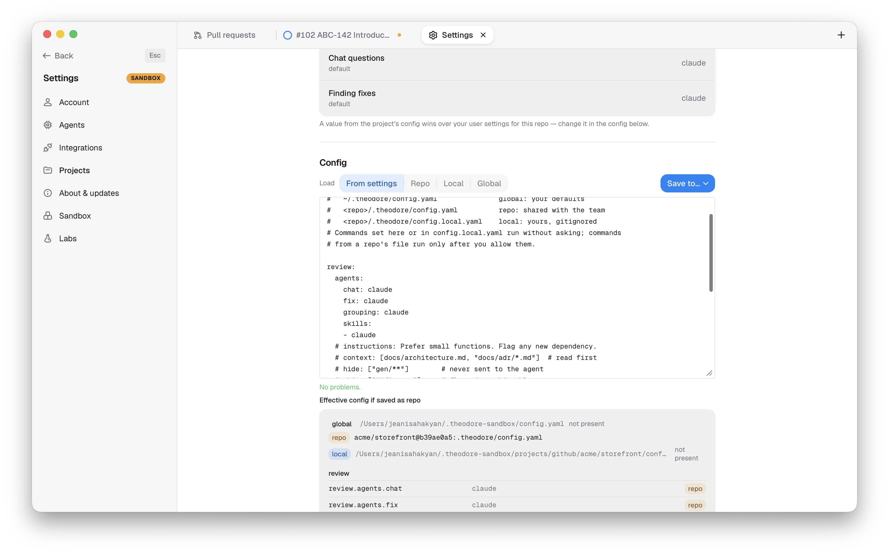 **Project config** — created from your settings, checked as you type, saved to the repo (as a PR), locally or globally. |
| 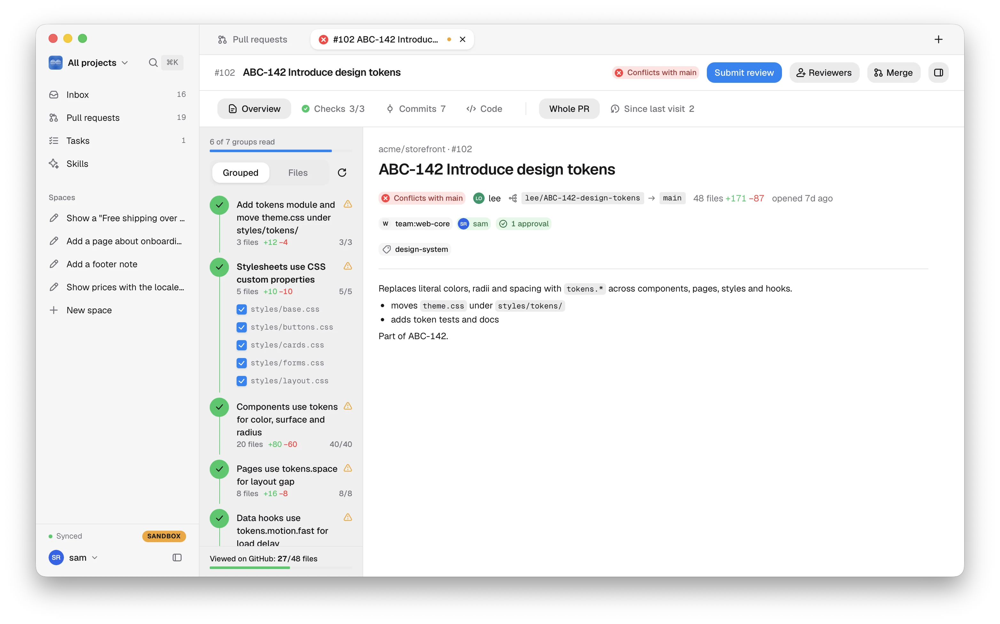 **Overview** — the full title, branches, reviewers and approvals, labels and the description. | 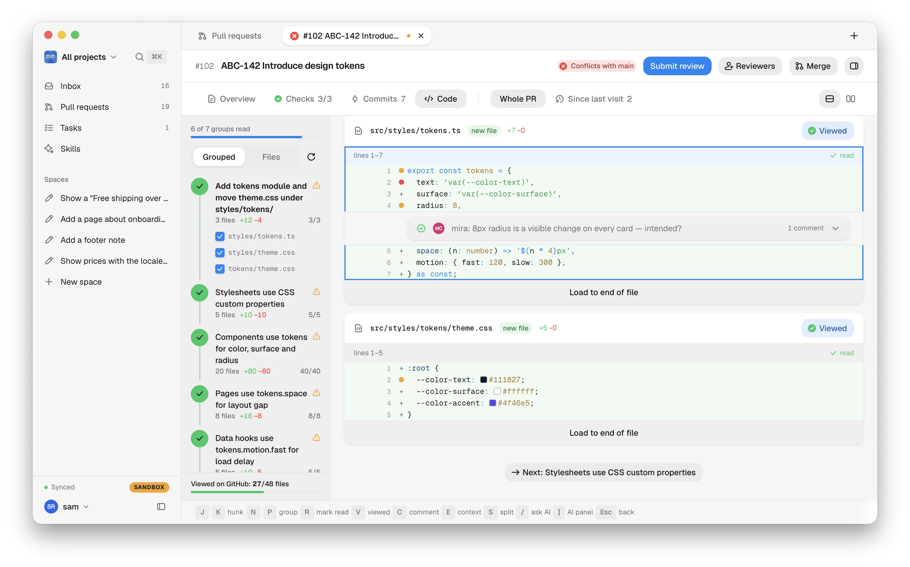 **Colour swatches** — every colour literal in code gets one; hover for hex, rgb and hsl. |
| 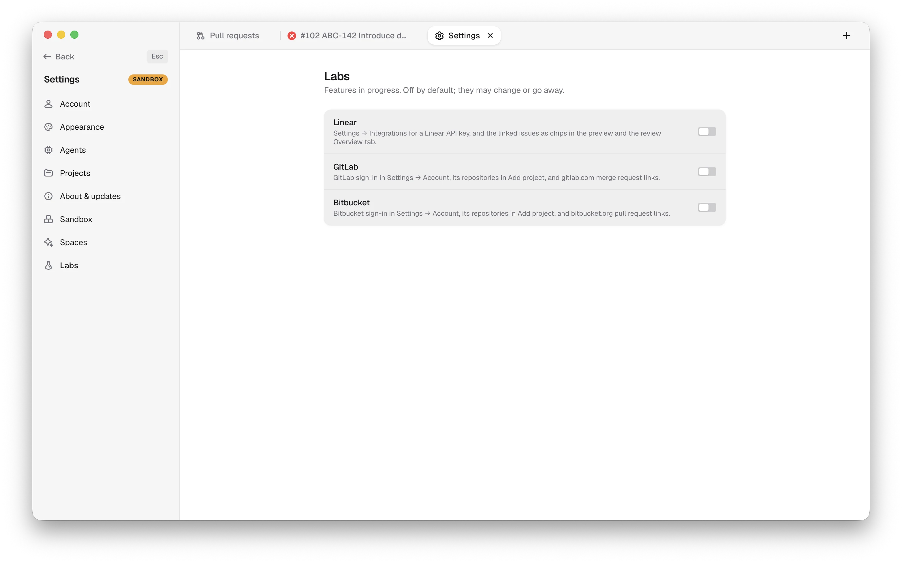 **Labs** — features in progress, off by default: Linear, GitLab, Bitbucket. | 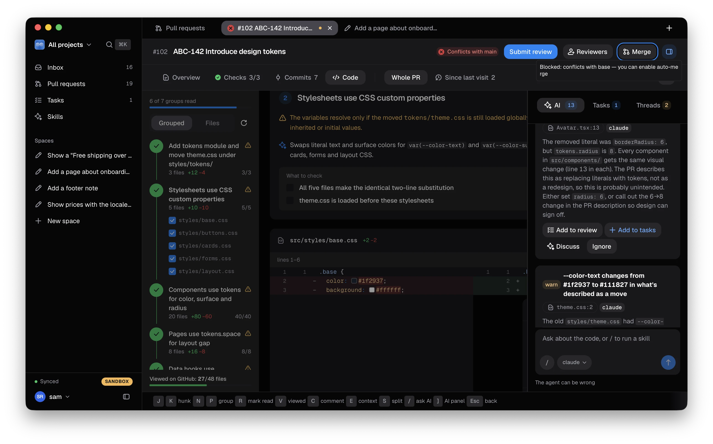 **Dark theme** — or System, which follows macOS. |

Retake them with the sandbox: `theodore sandbox init <dir>`, then run the app
with `THEODORE_SANDBOX=<dir>` and `"agents": "real"` in `scenario.json`.
